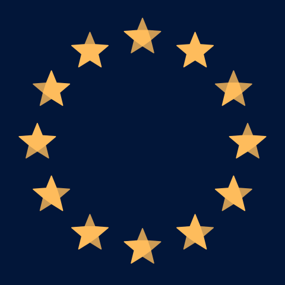
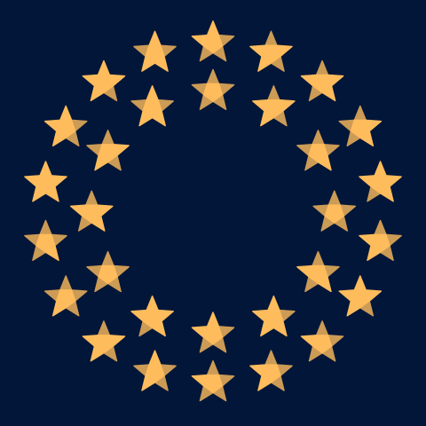
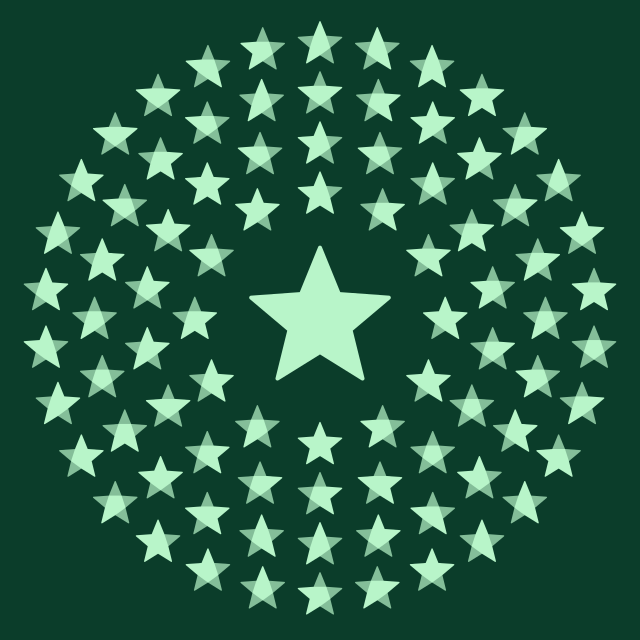
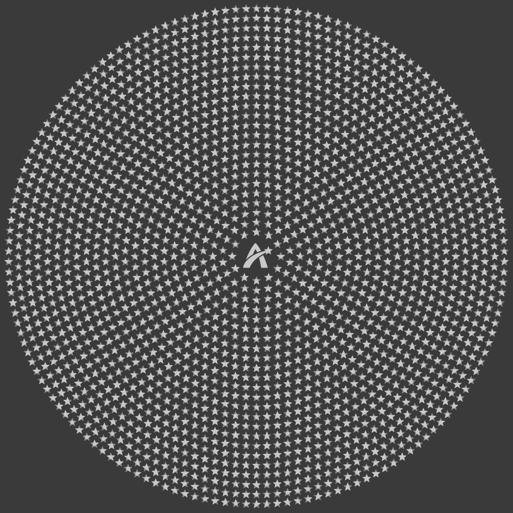

# Astracode

A Eurocoded solution for all your sub-kb scanning needs.

Astra means stars but also [Astra Europa](https://astraeuropa.eu)

## The code

- Looks like a turbocharged EU flag.
- 1-24 layers, 12-1944 stars, up to 1kb of data.
- Blazingly fast scanner written in Rust.
- Scans in any orientation, even flipped.
- All colors supported.
- No false positives.
- Optional custom logo in the center.

## Subtlety

One of the key features of Astracode is subtlety. I doesn't look like a code
unless you know what you're looking for. You can adjust the contrast of the data bits
to make it either more subtle or easier to scan in worse conditions.

## Examples

| 1 layer · `Star` | 1 layer · `star` | 2 layers · `Astra` | 2 layers · `astra` |
|:-:|:-:|:-:|:-:|
|  |  |  |  |

| 4 layers · a link | 5 layers · the EU motto |
|:-:|:-:|
|  |  |

| 24 layers · Schiller's Ode to Joy, 728 bytes |
|:-:|
|  |

The lighter limbs carry 80% of the ink in the small ones, 70% in the 4- and 5-layer ones and 60% in the 24-layer one.

The emoji is from Google's [Noto Emoji](https://github.com/googlefonts/noto-emoji); its licence is in `examples/`.

## Try it

```sh
cd rust && cargo build --release
target/release/astracode encode "https://example.org/" -o code.png
target/release/astracode scan photo.jpg
```
